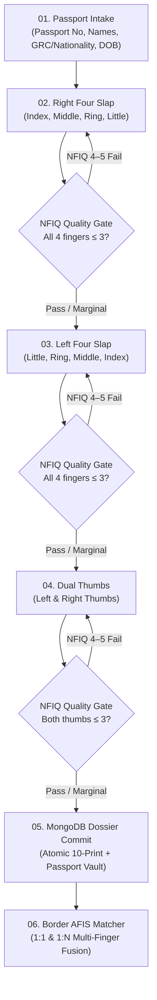

# Greece Visa Biometrics Workstation — Architecture & Design System (`design.md`)

## 1. Executive Summary & Design Vision

**Slap Biometrics Studio** is engineered as a consular-grade biometric enrollment and verification workstation adhering to the **Hellenic Republic & Schengen Visa Information System (VIS)** standard.

The workstation executes the official **Passport Demographics Intake ➔ 4–4–2 Ten-Print Optical Slap Acquisition Protocol**:
1. **Passport Demographics Intake**: Applicant identification captured strictly as per Machine Readable Travel Document (MRTD) passport standards.
2. **Right Four Slap (4 Fingers)**: Right Index → Middle → Ring → Little with real-time NIST NFIQ 1–5 scoring and strict gating.
3. **Left Four Slap (4 Fingers)**: Left Little → Ring → Middle → Index with identical quality enforcement.
4. **Dual Thumbs (2 Fingers)**: Left Thumb & Right Thumb captured simultaneously to complete the 10-print composite.
5. **MongoDB Dossier Persistence**: Atomic persistence of the full consular record into MongoDB collection `visa_dossiers` (with local SQLite backup).
6. **AFIS Border Matcher**: 1:1 probe-to-dossier verification and 1:N database identification search.

---

## 2. Process Workflow Architecture: The Greece Visa 10-Print Pipeline



### Phase 01: Passport Identification & Demographics Intake
- **Automated Passport Ingestion**:
  - **Upload Formats**: Supports PDF e-passports, mobile camera photos, and scanner images (`.pdf`, `.png`, `.jpg`, `.jpeg`, `.tiff`, `.bmp`, `.webp`).
  - **Integrated Engines**:
    - **PassportEye**: Specializes in ICAO Doc 9303 TD3 standard MRZ detection and decoding.
    - **pdfplumber**: Performs high-res page rasterization (300 DPI) and structured text stream analysis.
    - **pytesseract**: Tesseract OCR engine for Visual Inspection Zone (VIZ) text and targeted bottom-crop MRZ recognition.
    - **pypdf**: Extracts embedded e-passport streams and raw PDF metadata.
  - **Validation & Checksums**: Computes and validates standard ICAO 9303 check digits (weights 7-3-1) for passport number, date of birth, and expiration date.
  - **Extracted Fields**:
    - Passport Number (e.g. `GR9842105`)
    - Surname / Family Name (e.g. `PAPADOPOULOS`)
    - Given Names / First Name (e.g. `NIKOLAOS`)
    - Nationality / Issuing State (e.g. `GRC - Greece`)
    - Date of Birth (`YYYY-MM-DD` converted from YYMMDD)
    - Gender / Sex (`M` / `F` / `X`)
    - Passport Expiry (`YYYY-MM-DD` converted from YYMMDD)
    - Visa Reference Number
- **Workflow Action**: **Confirm & Lock Passport Data ➔ Proceed to Right Four (4)**.

### Phase 02: Right Four Slap Acquisition (4 Fingers)
- **Anatomy**: Right Index, Right Middle, Right Ring, Right Little.
- **Optical Acquisition**: 1600 × 1500 px at 500 DPI uncompressed grayscale optical frame.
- **Segmentation**: Isolates 4 individual bounding boxes.
- **Quality Scoring (NIST NFIQ)**:
  - **NFIQ 1–2**: `PASS (High Quality)` — Emerald Badge.
  - **NFIQ 3**: `PASS (Marginal)` — Amber Badge.
  - **NFIQ 4–5**: `RECAPTURE (Fail)` — Red Badge.
- **Gating**: If any finger fails, progression is blocked with an explicit alert: *"Recapture Required: 1 or more fingers scored NFIQ 4–5"*. Once all pass, enables progression to Left Four.

### Phase 03: Left Four Slap Acquisition (4 Fingers)
- **Anatomy**: Left Little, Left Ring, Left Middle, Left Index.
- **Segmentation & Quality Assessment**: Evaluates all 4 fingers against the same NFIQ threshold.
- **Progression**: Once approved, 8 of 10 fingers are registered. Automatically activates Dual Thumbs.

### Phase 04: Dual Thumbs Acquisition (2 Fingers)
- **Anatomy**: Left Thumb & Right Thumb positioned side-by-side on the center platen.
- **Composite Completion**: Completes the full 10-print composite biometric record (`10 / 10`).

### Phase 05: Consular Dossier Finalization & MongoDB Persistence
- Atomically commits the complete document into MongoDB collection `visa_dossiers`:
  ```json
  {
    "passport_number": "GR9842105",
    "surname": "PAPADOPOULOS",
    "given_names": "NIKOLAOS",
    "nationality": "GRC",
    "date_of_birth": "1992-06-15",
    "gender": "M",
    "passport_expiry": "2032-06-14",
    "visa_ref": "GR-VIS-2026-8941",
    "visa_type": "SCHENGEN_C_TOURIST",
    "station_id": "ATH-CONSULAR-01",
    "finger_count": 10,
    "status": "ENROLLED_10_PRINT",
    "fingers": [
      {
        "finger_name": "Right index",
        "group": "right4",
        "nfiq_score": 1,
        "quality_rating": "PASS (High Quality)",
        "minutiae_count": 52
      }
    ]
  }
  ```
- Renders the verified Schengen Biometric Dossier Certificate card with dossier ID, quality matrix, and status: **"SCHENGEN VIS COMPLIANT · ENROLLED"**.

### Phase 06: Border Control AFIS Verification (1:1 & 1:N)
- Evaluates probe slaps against enrolled dossiers:
  - **1:1 Verification**: Fast verification against applicant's passport file.
  - **1:N Search**: Ranked watchlist and border-crossing search.
- Conservative minimum-finger fusion: requires all requested anatomical fingers to satisfy threshold.

---

## 3. Database Architecture & Dual-Store Redundancy

The workstation features dual-database persistence and synchronization:
1. **MongoDB (`mongo:7.0` service)**:
   - Primary document store running on internal Docker network `mongo:27017` and bound to `127.0.0.1:27017`.
   - Stores rich applicant dossiers, complete 10-print composite minutiae arrays, base64 500 DPI optical images, NFIQ scores, bounding boxes, and consular metadata in collection `visa_dossiers`.
   - Indexed on `passport_number`, `subject_id`, and `created_at`.
2. **Local SQLite WAL Vault**:
   - High-speed relational AFIS cache (`biometrics.db`) storing raw template bytes, biometric records, and image blobs with `PRAGMA journal_mode=WAL;`.
   - Automatic cascade deletion (`ON DELETE CASCADE`) to keep database integrity spotless.

---

## 4. Database Center (`/database`)

A dedicated administrative and audit center accessible at `/database` on another route without requiring token authentication on localhost:

- **Route & Access**:
  - `GET /database`: Renders executive dark-mode Database Center (`app/templates/database.html`).
  - Navigation between main workstation (`/`) and Database Center (`/database`) via top header buttons (`Database Center` and `‹ Acquisition Station`).
  - Completely open and accessible on localhost without requiring Bearer token headers.

- **Biometric Inspection & Data Access**:
  - `GET /api/database/records`: Returns all applicant dossiers and reconstructs any offline SQLite subjects into full records with all 10 enrolled fingerprints, base64 images, NFIQ quality badges, and minutiae counts.
  - `GET /api/database/records/{identifier}`: Returns a single applicant's full demographic and biometric payload.
  - `GET /api/database/stats`: Returns aggregate metrics (total applicants, total fingerprints, 10-print completion count, NFIQ 1–2 high quality pass rates).
  - Modal Inspector with enlarged 500 DPI fingerprint plates, individual quality badges, and raw technical JSON view.
  - Individual and bulk JSON export (`Download JSON` / `Export All JSON`).

- **Deletion & Maintenance**:
  - `DELETE /api/database/records/{identifier}`: Atomically deletes an applicant's dossier and all associated fingerprints from both MongoDB (`dossiers.delete_one`) and SQLite (`subjects` + cascade `fingerprints`).
  - `DELETE /api/database/records`: Purges all applicant dossiers, biometric plates, and templates from both databases after requiring typed confirmation (`DELETE`).

- **UI / Terminology Strict Compliance**:
  - Zero mention of MongoDB or underlying DBMS names on the frontend.
  - Formatted strictly as "Central Biometric Database", "Schengen Biometric Vault", and "National Biometric Registry".

---

## 5. Universal Biometric Image Converter (100% Full Quality)

To guarantee complete portability and reusability on external AFIS, law enforcement, and border control platforms, the Database Center includes an integrated 100% Quality Format Conversion Engine:

### Supported Target Formats & Quality Guarantees
1. **TIFF (Tag Image File Format)**:
   - 100% Lossless LZW compression.
   - Preserves exact 500 DPI horizontal and vertical resolution tags (`dpi=(500, 500)`).
   - Global standard for FBI / NIST archival forensic records (NIST Special Publication 500-290).
2. **BMP (Windows Bitmap)**:
   - 100% Lossless uncompressed 8-bit grayscale raster buffer.
   - Standard format ingested by commercial hardware SDKs (Mantra, SecuGen, DigitalPersona, Suprema, ZKTeco).
3. **PNG (Portable Network Graphics)**:
   - 100% Lossless Deflate compression at 500 DPI.
   - Universal interoperability for web and cloud AFIS APIs.
4. **JPEG (Joint Photographic Experts Group)**:
   - Executed at `quality=100` with zero chroma subsampling (`subsampling=0` / 4:4:4).
   - Embedded 500 DPI metadata.
5. **WEBP**:
   - 100% Lossless WebP compression at 500 DPI.
6. **RAW / BIN (8-bit Grayscale Pixel Byte Stream)**:
   - Uncompressed $W \times H$ raster bytes without header wrapper.
   - Native input format for microcontrollers, embedded biometric matchers, and C/C++ AFIS libraries.

### 100% Lossless Optical Capture, Display & Download Pipeline
- **Lossless Optical Capture**:
  - Uncompressed 8-bit grayscale optical arrays ($1600 \times 1500$ px at 500 DPI) are encoded using mathematical DEFLATE with embedded physical dimensions (`pHYs` 500 DPI chunk).
  - Exact pixel-for-pixel mathematical equality verified across all acquisition stages.
- **Lossless Ridge Display Rendering**:
  - Canvases enforce `ctx.imageSmoothingEnabled = false;` to suppress browser interpolation/blurring.
  - CSS rule `image-rendering: pixelated; image-rendering: crisp-edges;` guarantees forensic-grade optical ridge clarity on high-DPI displays.
- **Lossless Download Mechanisms**:
  - `GET /api/capture/{capture_id}/download`: Downloads the raw $1600 \times 1500$ px 500 DPI optical slap frame 100% lossless.
  - `GET /api/database/export/{identifier}/zip?format=PNG`: Downloads the applicant's complete 10-print composite in lossless 500 DPI format.
  - `GET /api/database/export/all/lossless-zip?format=PNG`: Master registry archive downloading all applicants' 10-print collections in 100% lossless 500 DPI format with metadata manifests.

---

## 6. UI/UX Design System Tokens

| Token | Hex Value | Semantic Role |

|---|---|---|
| `--bg-dark` | `#06090e` | Deep carbon console background |
| `--bg-surface` | `#0b1118` | Elevated surfaces, tables, canvas frame |
| `--bg-card` | `#101924` | Workflow panels and modal boxes |
| `--border` | `#1a293b` | Structural boundaries |
| `--accent` | `#00e5a3` | Biometric pass indicator, scan beam, primary action |
| `--warning` | `#fbbf24` | NFIQ 3 (Marginal Pass) |
| `--danger` | `#f43f5e` | NFIQ 4–5 (Recapture Fail) |
| `--greek-blue` | `#0d5eaf` | Official Schengen / Hellenic Republic badge |
| `--cyan` | `#38bdf8` | Diagnostic tags and sample filler triggers |

---

## 7. Keyboard Navigation & Accessibility

- `Space`: Capture Slap
- `Esc`: Close open modal / walkthrough / inspection view
- `1` – `6`: Direct jump between workflow phases
- ARIA live region (`aria-live="polite"`) for real-time screen reader accessibility

